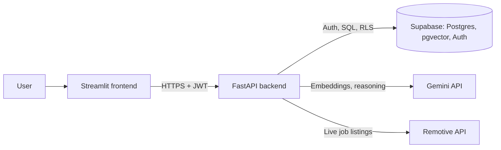

# AI Job-Search Co-Pilot

Upload your resume, see which jobs fit it and **why**, generate a tailored cover letter, track your applications, and let an agent find and score live remote jobs for you.

**Live demo:** [StreamlitAppURL](https://ai-job-copilot-project.streamlit.app/)
**API docs (Swagger):** [RenderURL](https://ai-job-copilot-ww75.onrender.com/docs)
**Demo login:** `demo@jobcopilot.com` / `Demo321` (or create your own account on the Sign up tab)

> The backend runs on a free Render instance that sleeps when idle, so the first load can take about a minute. The AI features run on Gemini's free tier, which has a small daily quota, so heavy use may return a "busy" message.

## Demo Walkthrough

[Download / Watch Full Walkthrough Demo (MP4)](https://github.com/Mohamedhashimoffl/ai-job-copilot/releases/download/v1.0.0/AiJobCopilot.mp4)

## What it does

- **Resume parsing:** upload a PDF or text resume. The text is extracted, split into chunks, embedded, and stored in Postgres with pgvector.
- **Semantic job matching:** jobs are ranked against your resume by cosine similarity, computed in the database.
- **Fit analysis with reasoning:** for a given job, the most relevant resume chunks are retrieved and Gemini returns a score, strengths, and gaps as structured JSON. It is told to use only evidence from the resume, so it can't invent skills.
- **Cover letters:** generated from the job, the retrieved resume evidence, and the confirmed strengths, with no mention of gaps.
- **Application tracker:** create, list, update, and filter applications by status, with validation and follow-up rules (for example "applied 7+ days ago with no movement").
- **Agent:** give it a goal in plain English and it searches live remote jobs, scores them against your resume, and adds strong matches to your tracker.

## Architecture



The frontend is a thin client: it only calls the API over HTTP and holds no business logic.

## How matching works

1. **Index:** on upload, the resume is split into chunks and each chunk is embedded (`gemini-embedding-001`, 768 dimensions) and stored.
2. **Retrieve:** the job description is embedded as a *query* and the closest resume chunks are fetched with a pgvector similarity function.
3. **Reason:** Gemini scores the fit using only those chunks, constrained to a JSON schema (`score`, `explanation`, `strengths`, `gaps`).

## The agent

The agent uses Gemini function calling with four tools: `search_job_matches`, `search_live_jobs`, `score_job_against_resume`, and `add_to_tracker`. It decides which tool to call next and loops until the goal is done. The model only *requests* a call; the backend runs it.

Scoring is not left to the model's judgment. `score_job_against_resume` calls the same retrieval and structured-output pipeline described above, so the agent orchestrates trusted logic instead of improvising.

Guardrails enforced in code, regardless of what the model decides:

| Guardrail | Limit |
|---|---|
| Turns per run | 6 |
| Tool calls per run | 8 |
| Repeated identical call | stops on the 3rd |
| Wall-clock time | 60 seconds |

## Tech stack

- **Backend:** FastAPI, Pydantic, pdfplumber
- **Database and auth:** Supabase (Postgres, pgvector, Auth, Row Level Security)
- **AI:** Google Gemini API (`google-genai`): embeddings, structured output, function calling
- **Frontend:** Streamlit
- **Infra:** Docker, docker-compose, Render (API), Streamlit Community Cloud (UI)
- **Tests:** pytest, pytest-mock

## Project structure

```
app/
  main.py
  api/          routers: auth, resumes, matches, applications
  core/         Supabase and Gemini clients, auth dependencies
  services/     parsing, chunking, embeddings, matcher, cover letter, agent
streamlit_app/  Streamlit UI (talks to the API over HTTP only)
supabase/
  schema.sql    tables, RLS policies, SQL functions, auth trigger
tests/          pytest suite
Dockerfile
docker-compose.yml
```

## Run it locally

1. Clone and install:
   ```bash
   git clone https://github.com/Mohamedhashimoffl/ai-job-copilot.git
   cd ai-job-copilot
   python -m venv venv && source venv/bin/activate
   pip install -r requirements.txt
   ```
2. Create a free [Supabase](https://supabase.com) project, open the SQL Editor, and run `supabase/schema.sql`. Under Authentication, turn off "Confirm email" for local testing.
3. Get a free Gemini API key from [Google AI Studio](https://aistudio.google.com).
4. Copy `.env.example` to `.env` and fill in the values:
   ```
   GEMINI_API_KEY=
   SUPABASE_URL=
   SUPABASE_KEY=
   SUPABASE_SECRET_KEY=   # only used by the seed script
   ```
5. Optional: seed a few sample jobs with `python -m app.services.seed_jobs`.
6. Start the backend and the frontend in two terminals:
   ```bash
   uvicorn app.main:app --reload
   cd streamlit_app && streamlit run app.py
   ```

Or run both with Docker: `docker compose up --build` (UI on `localhost:8501`, API on `localhost:8000`).

## Tests

```bash
pytest tests/ -v -m "not integration"
```

Deterministic logic (chunking, follow-up rules) is tested with exact assertions. AI output can't be asserted exactly, so those tests check the shape of the result and relationships such as "a strong match scores higher than a weak one". Agent tool logic is tested with mocked database calls and no real API requests. Tests marked `integration` call the real APIs and need a real resume id.

## Deployment

- **API:** Render, as a Docker web service, with `GEMINI_API_KEY`, `SUPABASE_URL`, and `SUPABASE_KEY` set as environment variables.
- **UI:** Streamlit Community Cloud with the secret `API_BASE` pointing at the Render URL.

## Design decisions

- **Security in the database:** Row Level Security enforces that users only see their own data, in addition to the user-id filters in the API code.
- **Agents orchestrate, they don't improvise:** scoring is a deterministic pipeline exposed as a tool.
- **Guardrails in code, not in the prompt:** limits on turns, tool calls, repeats, and time can't be talked around by the model.
- **Computed, not stored:** follow-up reminders are derived from dates when requested, so they are always current and need no background job.
- **Different embedding task types:** documents are embedded as `RETRIEVAL_DOCUMENT` and job descriptions as `RETRIEVAL_QUERY`, which is what the embedding model is trained for.

## Known limitations

- Free-tier limits: Gemini has a small daily request quota and Render sleeps when idle.
- Live jobs come from Remotive's public feed, which is small, so some searches return few or no results.